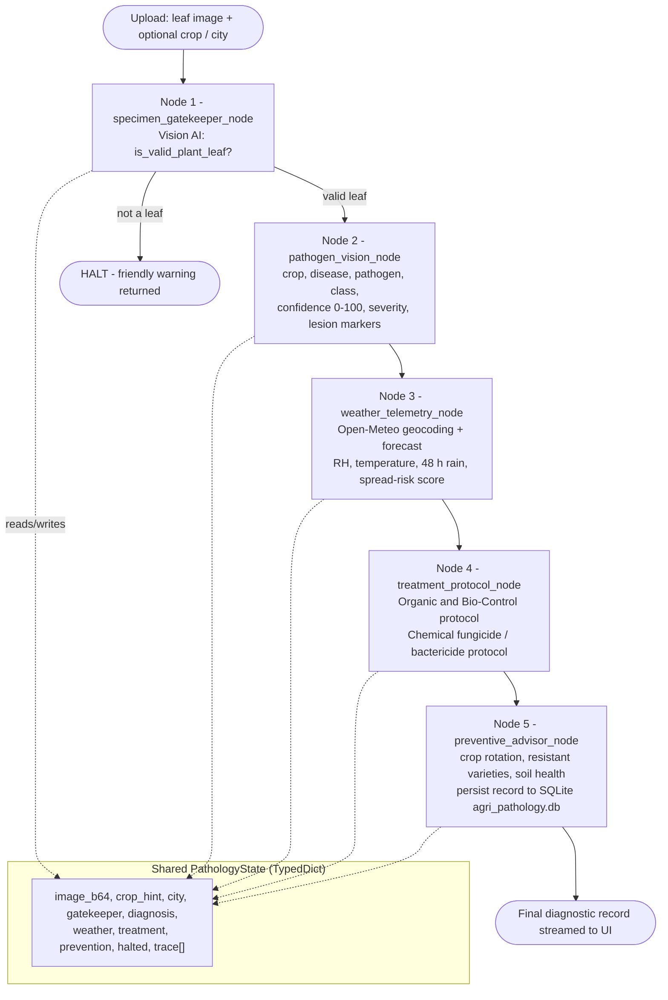

# Agentic Multi-Modal Plant Pathology & Treatment System via LangGraph

A locally runnable full-stack web app that diagnoses plant-leaf disease from a photo using a genuine
**5-node stateful LangGraph pipeline**, enriches it with live **Open-Meteo** microclimate risk, and prescribes
a dual-track **Organic vs. Chemical** treatment plan - with progression comparison, a
scan-history archive and a printable PDF report.

* Backend: Python 3.10+ · FastAPI · Uvicorn · LangGraph · LangChain (Gemini + Groq) · SQLite
* Frontend: plain HTML / CSS / JS served by FastAPI - **no Node.js, no npm, no build step, no GPU**
* Runs on an 8 GB RAM laptop; all heavy lifting is done by free hosted AI APIs

## Quick start

1. Install **Python 3.10+** (Windows: <https://www.python.org/downloads/>, tick *Add python.exe to PATH*).
2. Run one command:

   | OS | Command |
   |----|---------|
   | Windows | double-click `start.bat` (or run it in a terminal) |
   | Linux / macOS | `chmod +x start.sh && ./start.sh` |

   The script creates a virtual environment, installs `requirements.txt`, copies `.env.example` to `.env`,
   generates the sample images, starts the server and opens <http://127.0.0.1:8001>.
3. Add a **free** AI key - either click **API Keys** in the app and paste it (no file editing), or put it in `.env`:
   * Gemini (primary): <https://aistudio.google.com/apikey> → `GEMINI_API_KEY`
   * Groq (fallback): <https://console.groq.com/keys> → `GROQ_API_KEY`

   With both set, the app fails over automatically (Gemini → Groq) if a provider errors or is rate-limited.

Manual run: `pip install -r requirements.txt && python run.py`

## LangGraph architecture



* **Conditional edge** after Node 1 routes invalid specimens straight to `END`.
* Each node is wrapped by `@traced`, which appends `{node, status, ms, detail, provider}` to the state's
  `trace` list (an `operator.add` reducer). `/api/analyze` streams these as NDJSON so the UI's pipeline
  visualizer shows **real** per-node latency.
* Node 3 degrades gracefully: no city, unknown city or no network → the node is marked *skipped* and the rest continues.
* LLM replies are requested as JSON, parsed defensively and validated/normalised by Pydantic (`app/schemas.py`);
  confidence is clamped to 0-100 (max 97) and pathogen class / severity are forced into the allowed values.

### Spread-risk score (Node 3)

`score = (humidity 0-40 + temperature 0-25 + 48 h rainfall 0-35) × class weight`
(Fungal/Bacterial 1.0 · Healthy 0.8 · Viral 0.6 · Pest/Nutrient 0.5) → **Low** < 35 ≤ **Moderate** < 65 ≤ **High**.
Humidity blends current RH with the 48 h average; temperature is optimal at 18-28 °C.

## Features

| View | What it does |
|------|--------------|
| **Diagnose** | Drag-and-drop uploader with zoom/pan preview, crop + city inputs, 1-click sample bar, animated 5-node pipeline with latency |
| **Diagnostic sheet** | Disease + scientific name, pathogen-class badge, radial confidence gauge, severity meter, microclimate banner, side-by-side Organic vs. Chemical protocols, prevention plan |
| **Compare Progress** (v1.1) | Day 1 baseline vs. follow-up → Improving / Stable / Worsening with infected-area estimates and visual evidence |
| **Live timer + debug logs** | Ticking `0.0s` timer on the pipeline banner and a collapsible *Execution & Debug Logs* panel (per-node ms, provider/model, raw trace) |
| **History + report** (v1.1) | SQLite archive with search and class filters; **Print / Save PDF** report view (browser print dialog → *Save as PDF*) |
| **API Key Manager** | Paste a Gemini/Groq key in the browser; stored in local SQLite; only editable from localhost |

## Demo rate limiting

`/api/analyze` and `/api/compare` share one **sliding-window limiter** stored in SQLite
(table `rate_limit`): `RATE_LIMIT_PER_HOUR` (default **5**) requests per client IP per rolling hour. It survives restarts.
The header pill shows e.g. `5/5 Free Demo Scans Left This Hour` with a countdown to the next free slot; over the limit the API
returns HTTP **429** with a friendly message and a `Retry-After` header. Invalid uploads are rejected *before* a slot is consumed.
Set `TRUST_PROXY=1` only behind your own reverse proxy (otherwise `X-Forwarded-For` is ignored so it can't be spoofed).

## Bundled sample specimens

On first start `app/samples.py` downloads three **real, open-licence photographs** from Wikimedia Commons (httpx with a
proper `User-Agent`), centre-crops them to 768x768 JPEG (three leaves plus one natural non-plant control photo). Licences are listed in
`static/samples/CREDITS.txt`. Delete a file to have it fetched again.

| File | Expected result |
|------|-----------------|
| `healthy_leaf.jpg` | Healthy tomato foliage, no chemical treatment needed |
| `early_blight_leaf.jpg` | Fungal, *Alternaria solani* concentric lesions on tomato |
| `powdery_mildew_leaf.jpg` | Fungal, white powdery coating |
| `non_leaf_control.jpg` ("Non-Leaf / AI Control", a coffee-mug photo) | Gatekeeper rejects it, pipeline halts with a warning card |

## Speed

Images are resized to max 768 px / JPEG q82 in the browser (canvas) and again on the server (Pillow), keeping the AI payload
around 100 KB. Node 1 is a short call (150 tokens, 12 s timeout); nodes 2, 4 and 5 share **one** structured JSON call
(1100 tokens, 22 s timeout) that runs in parallel with node 3's Open-Meteo fetch (5 s timeout).

## Configuration (`.env`)

See `.env.example`. Key settings: `GEMINI_API_KEY`, `GROQ_API_KEY`, `RATE_LIMIT_PER_HOUR`, `HOST`, `PORT`, `MAX_UPLOAD_MB`, `DB_FILE`.
Groq retires preview models from time to time, so the vision model is configurable (`GROQ_VISION_MODEL`, with
`GROQ_VISION_MODEL_FALLBACK` tried as a second option).

## API

| Method & path | Purpose |
|---|---|
| `GET /` | Console UI |
| `POST /api/analyze` | multipart `file`, `crop`, `city` → NDJSON stream (`start`, `node`…, `result` / `error`) |
| `POST /api/compare` | multipart `baseline`, `followup`, `crop` |
| `GET /api/history`, `GET/DELETE /api/history/{id}` | Scan archive (per client IP) |
| `GET /api/quota`, `GET /api/status` | Quota and provider status |
| `POST /api/keys`, `DELETE /api/keys/{provider}` | Browser key manager (localhost only) |

Interactive docs: <http://127.0.0.1:8001/docs>

## Project layout

```
app/            config, db, ratelimit, imaging, llm (failover), schemas, prompts, weather, graph (LangGraph), samples, main (FastAPI)
static/         index.html, css/style.css, js/app.js, samples/ (downloaded on first run)
run.py          server launcher        start.bat / start.sh   one-command startup
```

## Safety disclaimer

AI output is decision support only and can be wrong. Confirm with a qualified agronomist, follow pesticide labels, wear the
specified PPE, respect pre-harvest intervals and local regulations. The app never states brand-specific dosages.


Run this command 

Windows (PowerShell):
python -m venv .venv; .\.venv\Scripts\python.exe -m pip install -r requirements.txt
.\.venv\Scripts\python.exe -m uvicorn app.main:app --host 127.0.0.1 --port 8001

macOS / Linux (Terminal):
python3 -m venv .venv && ./.venv/bin/python -m pip install -r requirements.txt
./.venv/bin/python -m uvicorn app.main:app --host 127.0.0.1 --port 8001
